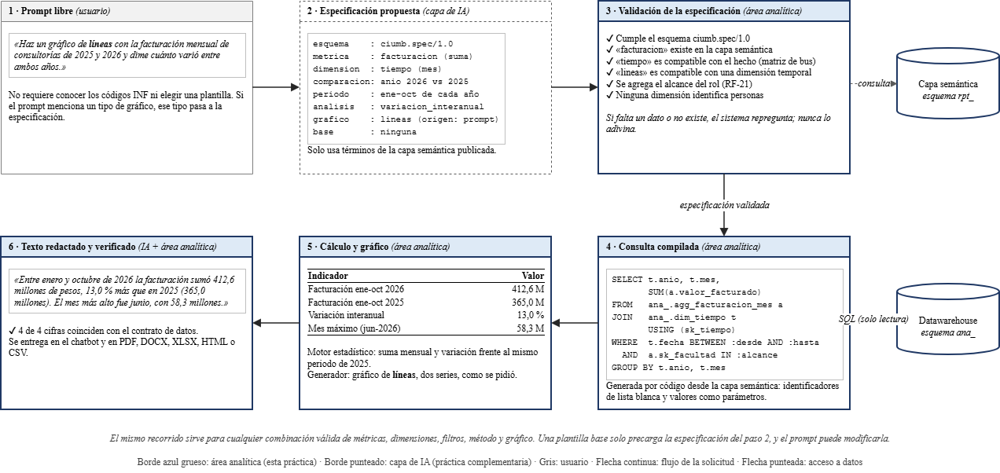
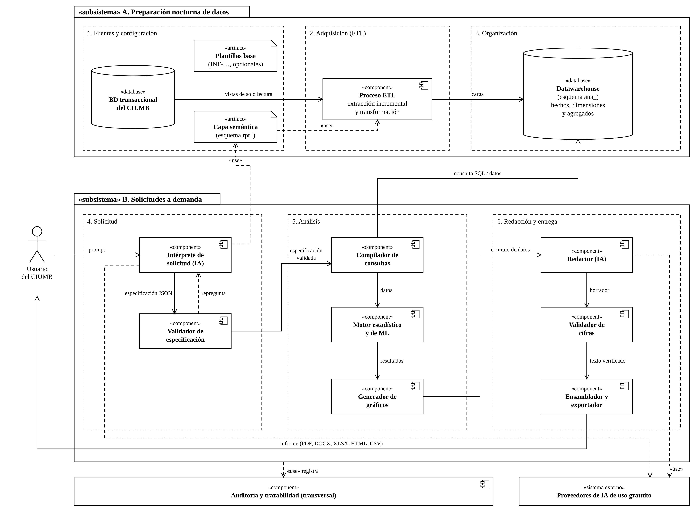
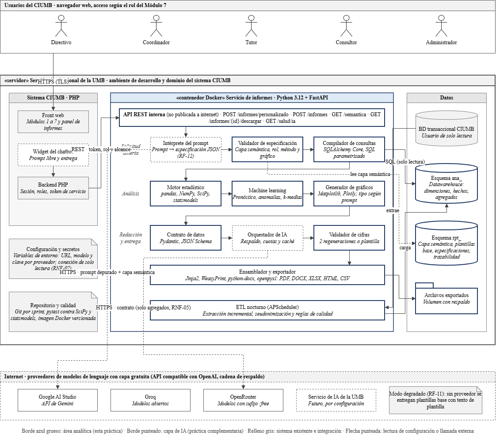
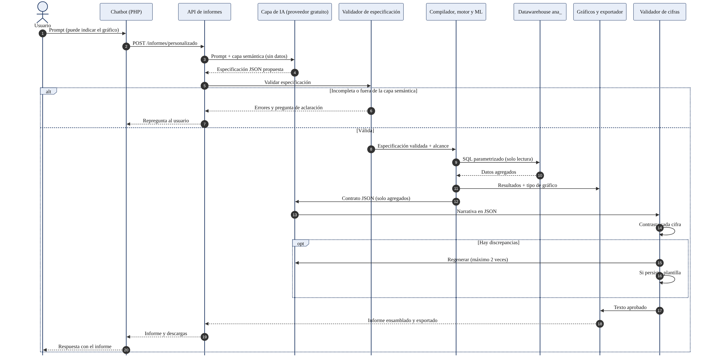
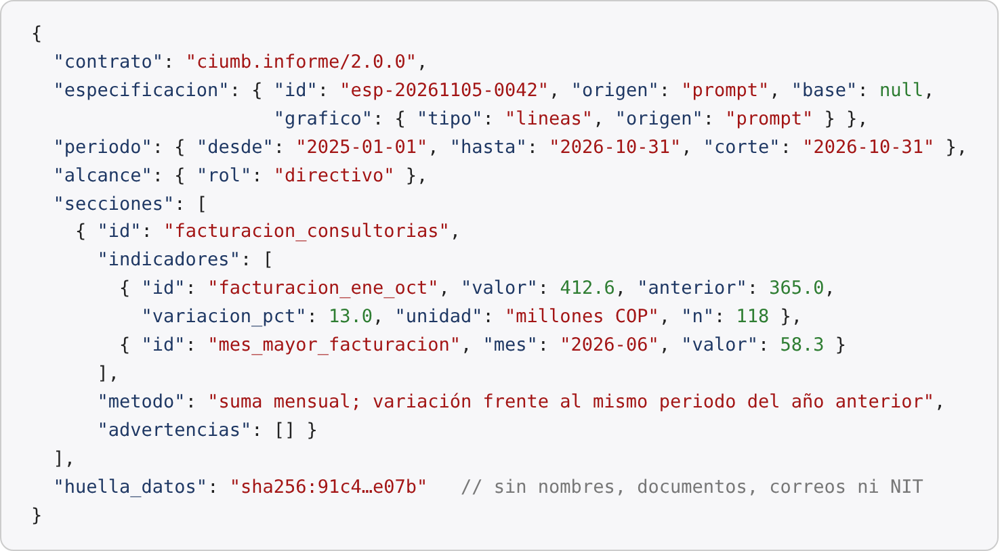
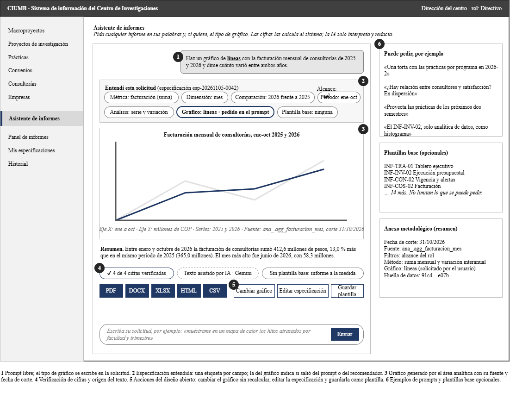

# Motor de informes CIUMB · área analítica

Práctica Empresarial II · Ingeniería de Software · Universidad Manuela Beltrán.
Autor: Daniel Barragán. Supervisor: Ing. Héctor Vargas (Centro de Investigaciones, CIUMB).

Servicio en Python que convierte una pregunta de un usuario del CIUMB en un **informe con cifras verificadas**:
valida lo que se pide, consulta el datawarehouse, calcula las cifras con librerías estadísticas, dibuja el
gráfico y exporta el informe a PDF, DOCX, XLSX, HTML o CSV. La redacción en lenguaje natural la hace una capa
de IA separada, y este servicio comprueba que cada número de ese texto coincida con lo calculado.

> **La idea central:** la IA entiende la pregunta y redacta, pero **nunca produce una cifra ni escribe SQL**.
> Todo número sale del motor estadístico. Si la IA no está disponible, el informe sale igual con un texto de
> plantilla.

---

## Cómo funciona, en un ejemplo

Un directivo escribe: *«Haz un gráfico de líneas con la facturación mensual de consultorías de 2025 y 2026 y
dime cuánto varió entre ambos años»*. La solicitud recorre seis pasos:



1. **Prompt libre** del usuario: no necesita conocer códigos de informe.
2. La **capa de IA** lo traduce a una especificación JSON (`ciumb.spec/1.0`) con términos de la capa semántica.
3. Este servicio **valida la especificación**: que las métricas existan, que sean compatibles, el alcance del
   rol y que ninguna dimensión identifique personas. Si falta algo, se repregunta; nunca se adivina.
4. El **compilador** genera SQL parametrizado de solo lectura, con identificadores de una lista blanca.
5. El **motor** calcula las cifras (pandas, SciPy, statsmodels, scikit-learn) y el **generador** dibuja el gráfico.
6. La IA redacta y el **validador de cifras** contrasta cada número del texto con el contrato de datos.

## Arquitectura

### Bloques del área analítica

El trabajo se divide en un subsistema nocturno que prepara los datos y otro que atiende solicitudes a demanda.



| Bloque | Qué hace | Código |
|---|---|---|
| 1. Fuentes y configuración | Vistas de solo lectura sobre la BD del CIUMB; capa semántica y plantillas | `fuentes/`, `semantica/` |
| 2. Adquisición (ETL) | Extracción incremental, seudonimización y reglas de calidad | `etl/` |
| 3. Organización | Datawarehouse `ana_`: dimensiones, hechos y agregados | `dw/` |
| 4. Solicitud | Validador de la especificación (el intérprete del prompt es de la capa de IA) | `spec/` |
| 5. Análisis | Compilador de consultas, motor estadístico y de ML, generador de gráficos | `compilador/`, `motor/`, `ml/`, `graficos/` |
| 6. Redacción y entrega | Contrato de datos, validador de cifras, ensamblador y exportador | `contrato/`, `validador_cifras/`, `exportacion/` |
| Transversal | Auditoría y trazabilidad en `rpt_` | `trazabilidad/`, `api/` |

### Arquitectura general de la solución

El servicio corre en un contenedor Docker dentro del servidor institucional. El sistema PHP del CIUMB le envía
las solicitudes con un token de servicio; la capa de IA (borde punteado) habla con los proveedores de modelos.



### Secuencia de una solicitud



En el código, ese recorrido es `api.flujo.procesar`:

```
validar -> compilar -> ejecutar -> revisar_datos -> motor / ML -> generar_grafico -> empaquetar
        -> [capa de IA: redactar] -> validar_con_regeneracion (máx. 2) -> exportar -> registro en rpt_
```

### Contrato de datos

Lo que viaja hacia la capa de IA es solo un paquete de **agregados**, sin registros ni datos personales. Un
campo desconocido invalida el paquete y un filtro de patrones (correos, documentos, NIT) bloquea el envío.



Esquemas JSON (draft 2020-12), validables desde cualquier lenguaje:
`schemas/ciumb.spec-1.0.schema.json` (lo que envía la IA) y `schemas/ciumb.informe-2.0.0.schema.json` (lo que
recibe). Ejemplos de los 10 prompts de prueba en `schemas/fixtures/`.

### Cómo lo ve el usuario

Prototipo del asistente de informes en el chatbot del CIUMB (lo construye el equipo de integración):



---

## Estado actual

| Componente | Estado |
|---|---|
| Especificación, capa semántica, validador y compilador | Hecho |
| Motor estadístico (descriptiva, series, inferencia) | Hecho, contrastado con NumPy y SciPy |
| ML (pronóstico, atípicos, segmentación) | Hecho, contrastado con statsmodels y scikit-learn |
| Gráficos (barras, líneas, torta, dispersión, mapa de calor, histograma) | Hecho |
| Contrato de datos, filtro de PII y validador de cifras | Hecho |
| ETL nocturno al datawarehouse `ana_` | Hecho, probado en PostgreSQL 16 |
| Exportación PDF, DOCX, XLSX, HTML, CSV | Hecho (PDF en Linux/Docker) |
| Orquestación, API y trazabilidad | Hecho; la capa de IA se conecta cuando se cierre su interfaz |
| Pruebas de aceptación de los 10 prompts (Tabla 22) | Pasan de punta a punta; faltan las métricas de la Tabla 2 |

Pruebas: 701 en verde en Linux. Mientras la capa de IA no esté conectada, los informes salen en **modo
degradado** (texto de plantilla); las cifras, gráficos y archivos son los reales del motor.

---

## Puesta en marcha

Requisitos: Python 3.12, [uv](https://docs.astral.sh/uv/) y Docker.

```bash
uv sync                                    # dependencias
cp .env.example .env                       # completar contraseñas, sal y token de servicio
docker compose up -d db                    # PostgreSQL de desarrollo
uv run python -m datos_sinteticos.generar  # datos sintéticos de la BD del CIUMB (modelo inferido)
uv run --env-file .env python -m ciumb_analitica.etl --historico 2019-01   # ETL hacia ana_
uv run python -m pytest                    # pruebas
```

Para el servicio se necesita, una vez, sembrar la capa semántica en `rpt_` (`semantica.almacen.sembrar`) y dar
permiso de inicio de sesión al usuario de solo lectura (ver el final de `sql/ana_rpt_postgresql.sql`).
El detalle está en `docs/handoff.md`.

**Levantar el servicio**

```bash
# local
uv run --env-file .env uvicorn ciumb_analitica.api.app:app

# en contenedor (necesario para el PDF: WeasyPrint usa bibliotecas de Linux)
docker build -t ciumb-analitica:dev .
docker run -d -p 8000:8000 --env-file <.env con host.docker.internal en lugar de localhost> ciumb-analitica:dev
```

## Verlo en acción

Con el servicio arriba en `http://localhost:8000`:

- **Demostración completa:** `uv run --env-file .env python herramientas/demo.py` pide los 10 prompts de
  prueba, guarda el HTML y el PDF de cada informe en `informes_demo/` y abre el primero en el navegador.
  Para algunos: `... demo.py p03 p04 p10`.
- **Interactiva:** abrir `http://localhost:8000/docs`, pulsar *Authorize* con el `SERVICIO_TOKEN` del `.env` y
  probar `POST /informes/personalizado` con la `spec` de cualquier archivo de `schemas/fixtures/`.

### Rutas de la API

| Ruta | Para qué |
|---|---|
| `GET /salud` | Vida del servicio (sin token) |
| `GET /semantica` | Métricas y dimensiones que se pueden pedir (para la capa de IA) |
| `GET /informes/catalogo?rol=` | Plantillas base disponibles para un rol |
| `POST /informes/personalizado` | Informe a la medida desde una especificación |
| `POST /informes` | Informe de una plantilla base con el alcance del usuario |
| `GET /informes/{id}/descargar?formato=` | Archivo del informe (pdf, docx, xlsx, html, csv) |

Todas, salvo `/salud`, exigen `Authorization: Bearer <SERVICIO_TOKEN>`. Una especificación que no se puede
atender responde con `estado` (`corregible` o `fuera_de_alcance`) y los problemas, para repreguntar al usuario.

---

## Reglas que no cambian

1. Ninguna cifra la produce la IA: todo número sale de SQL, pandas, SciPy, statsmodels o scikit-learn.
2. La IA no escribe SQL: solo nombra métricas y dimensiones por su código de la capa semántica.
3. El servicio lee con un usuario de solo lectura, solo el esquema `ana_`, con límite de filas y de tiempo.
4. A la capa de IA solo llegan agregados, sin datos personales; los grupos de menos de 5 personas se suprimen.
5. Nombres, documentos y correos no se extraen; los ids de personas se guardan como SHA-256 con sal secreta.
6. Misma especificación, mismo SQL, misma huella: los informes se pueden reproducir.
7. Muestras pequeñas: advertencia en el chi-cuadrado con esperados < 5 y en histogramas con < 20 datos; no se
   publica un pronóstico con menos de 12 puntos.
8. Sin IA, el informe se genera igual con texto de plantilla.
9. Si cambia el contrato de datos, sube su versión. Solo librerías de código abierto.

## Reparto del trabajo

| Parte | Responsable |
|---|---|
| Área analítica (este repositorio) | Daniel Barragán |
| Capa de IA: prompt -> especificación, proveedores de IA, redacción | Laura Valentina Maldonado |
| Integración con el sistema PHP del CIUMB | Juan Stiven Castro y Manuel Bonilla |

Para la capa de IA, el punto de partida es **`docs/interfaz_capa_ia.md`**: los dos documentos que se
intercambian y lo que falta por confirmar.

## Estructura del repositorio

```
src/ciumb_analitica/
  fuentes/           vistas de extracción sobre la BD del CIUMB (solo lectura)
  etl/               extracción, seudonimización, reglas de calidad, carga y programación nocturna
  dw/                esquema ana_ (dimensiones, hechos, agregados)
  semantica/         métricas, dimensiones y compatibilidades publicadas
  spec/              especificación ciumb.spec/1.0 y su validador
  compilador/        especificación -> SQL parametrizado
  motor/             descriptiva, series de tiempo, inferencia y método -> secciones del contrato
  ml/                pronóstico, atípicos, segmentación
  graficos/          seis tipos de gráfico
  contrato/          contrato 2.0.0 y filtro de datos personales
  validador_cifras/  cotejo de cifras del texto y plantilla sin IA
  exportacion/       PDF, DOCX, XLSX, HTML, CSV e identidad visual UMB
  trazabilidad/      esquema rpt_ (solicitudes, resultados, validaciones, caché)
  api/               orquestación del flujo y rutas FastAPI
schemas/             JSON Schema, ejemplos y fixtures de los 10 prompts
datos_sinteticos/    DDL del modelo inferido y generador con semilla fija
sql/                 DDL de ana_ y rpt_ para PostgreSQL
tests/               pruebas, con la misma estructura que src/
herramientas/        utilidades (demostración)
docs/                diseño por secciones, decisiones, backlog y estado actual
```

## Documentación

- `docs/diseno/00_indice.md`: el documento de diseño, dividido por secciones (las figuras están en
  `docs/diseno/figuras/`).
- `docs/decisiones.md`: decisiones de construcción que no estaban en el diseño.
- `docs/backlog.md`: historias por sprint.
- `docs/handoff.md`: estado actual, pendientes y cómo levantar el entorno.
- `docs/interfaz_capa_ia.md`: frontera con la capa de IA.

## Convenciones

- Nombres de dominio en español sin tildes (`hecho_proyecto`, `pct_ejecucion`).
- Cada función estadística se prueba contra la librería de referencia.
- Commits convencionales (`feat:`, `fix:`, `test:`, `docs:`).
- Secretos solo en `.env`, que no se sube. El motor de BD del CIUMB no está confirmado: el código no depende
  de uno concreto y en desarrollo se usa PostgreSQL con datos sintéticos.
